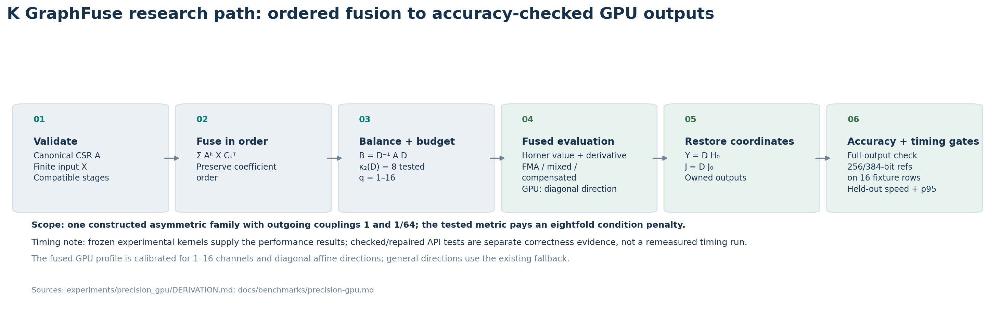
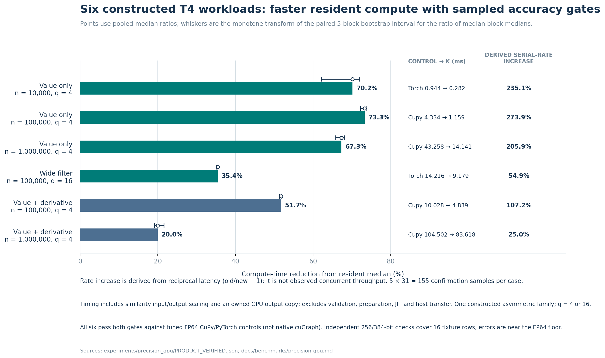

# K GraphFuse

**Reusable sparse graph filters, directional sensitivities, and optional GPU execution.**

**Created and maintained by [Utkarsh Sinha](https://github.com/Utkarsh-Sinha0).**
If this project supports your product or research, please credit **K GraphFuse by Utkarsh Sinha** and [cite the software](CITATION.cff).

[](https://github.com/Utkarsh-Sinha0/k-graphfuse/actions/workflows/ci.yml)
[](https://utkarsh-sinha0.github.io/k-graphfuse/)
[](LICENSE)

[Documentation](https://utkarsh-sinha0.github.io/k-graphfuse/) · [Quickstart](docs/getting-started/quickstart.md) · [API reference](docs/reference/api.md) · [Benchmark evidence](docs/benchmarks/results.md) · [Metric definitions](docs/benchmarks/metric-definitions.md) · [Research paper](docs/research/paper.md) · [Reproduce](docs/benchmarks/reproduce.md)

K GraphFuse compiles compatible linear graph stages into one ordered matrix polynomial, then evaluates it with sparse Horner recurrences. Reuse a copied operator and compiled plan across inputs. Optional backends cover CUDA execution, symmetric restarted resolvents, sparse local propagation, and derivatives with respect to one affine graph parameter.



It is useful when repeated graph ranking or linear propagation consumes a meaningful part of a workload. It requires matching graph semantics, independent accuracy checks, and enough repeated calls to recover preparation costs. Nonlinear graph neural networks, shortest paths, general graph transactions, and arbitrary dynamic topology updates are separate tasks.

## Audited benchmark evidence

| Study | Measured result | Comparison contract |
|---|---|---|
| Native NVIDIA cuGraph ranking study | **66.3% (59/89 attempted) strong speed wins**, including **29.2% (26/89) with both reference errors no worse** | 85 comparable cases and four K accuracy failures, counted as non-wins |
| Strongest tested alternatives | **38.8% (33/85) overall**, **44.7% (38/85) GPU** speed-gate wins | Fastest accepted recorded control, including CPU where measured |
| Experimental precision GPU filters | **~20.0–73.3% less median compute time** (1.25–3.74x; **~25.0–273.9% higher derived serial compute rate**) | Equivalent tuned FP64 CuPy/PyTorch; constructed sparse filters and derivatives |

For latency comparisons, `s = baseline median / K median`; compute-time reduction is `100 × (1 − 1/s)`, and the derived reciprocal-latency serial compute-rate increase is `100 × (s − 1)`. This rate is calculated from isolated median latency, not measured concurrent throughput. Strong native speed wins require at least 10% lower median, an interval above one, and no p95 regression. The 26 speed-and-error wins also have no worse recorded L1 and maximum-relative error; all 26 use matching precision. These counts do not establish better energy, memory or complete application runtime on every case.

[Native cuGraph metrics and all losses](docs/benchmarks/cugraph.md) · [Precision GPU latency, p95 and high-precision accuracy](docs/benchmarks/precision-gpu.md) · [Measurement contracts](docs/benchmarks/methodology.md)



The original same-T4 `datagen-7_5-fb` experiment recorded **21.28% less median compute time** (63.398 ms native / 49.906 ms K; `s=1.2703x`) or **27.03% higher derived serial rate**; sampled total GPU and process-memory peaks were 56.76% and 35.87% lower, while aggregate L1 error was worse. A later longer confirmation on that graph favors cuGraph. **Native cuGraph was 2.72x faster on the recorded Graph500-22 workload.** Complete file/rebuild workflows also favored native; see [all measured losses](docs/benchmarks/cugraph.md#negative-results-and-unsupported-tasks). The older 19-workload suite passed zero strongest GPU gates under its separate protocol. [Historical reference result](docs/benchmarks/historical-reference.md).

The new fused implementation lives in [experiments/precision_gpu](experiments/precision_gpu/README.md), separate from the installed `k_graphfuse` 0.1.0 API. Its repaired checked API passed 43 combined CPU/GPU tests; performance belongs to separately frozen timed versions. Raw samples, rejected configurations, code hashes and offline audits are included. Global SOTA, customer savings and integrated energy savings remain unestablished.

## Install and run

Python 3.11 or newer; CPU use requires NumPy and SciPy. Clone the repository and install locally:

```sh
git clone https://github.com/Utkarsh-Sinha0/k-graphfuse.git
cd k-graphfuse
python -m pip install .
python examples/quickstart.py
```

```python
import numpy as np
from scipy.sparse import csr_array
from k_graphfuse import compile_sparse, evaluate_sparse

a = csr_array([[0., 0.5], [0.25, 0.]])
x = np.array([[1.], [2.]])
stages = [[[[1]], [[1]]], [[[2]], [[1]]]]  # (I + A), then (2I + A)
plan = compile_sparse(a, stages, tolerance=0)
y = evaluate_sparse(plan, x)
```

For GPU use, install a CUDA-enabled PyTorch build compatible with your driver, then `python -m pip install ".[gpu]"`. Follow the [GPU guide](docs/guides/gpu.md). FP64 is the default; FP32 requires workload-specific acceptance. CUDA capture and packing can be slower or use more memory.

## Choose your path

| Need | Start here |
|---|---|
| Evaluate a linear graph-filter pipeline | [Quickstart](docs/getting-started/quickstart.md) |
| Integrate a reused CUDA operator | [GPU execution](docs/guides/gpu.md) |
| Differentiate a graph parameter | [Sensitivities](docs/guides/sensitivity.md) |
| Compute a symmetric restarted resolvent | [Resolvents and residual audit](docs/guides/resolvent.md) |
| Check a performance claim | [Results](docs/benchmarks/results.md), [methodology](docs/benchmarks/methodology.md), [raw evidence](evidence/README.md) |
| Assess ranking, fraud or retrieval fit | [Applications](docs/guides/applications.md) |
| Navigate with an AI coding agent | [AGENTS.md](AGENTS.md), [llms.txt](docs/llms.txt), [claims.json](docs/claims.json) |

## Verify and contribute

```sh
python -m unittest discover -s tests -v
python benchmarks/verify_evidence.py
python examples/sensitivity.py
python examples/resolvent.py
python -m pip install ".[docs]"
python -m mkdocs build --strict
```

CUDA tests skip when no CUDA device is available. Offline evidence verification recomputes reported timings and source hashes; it does not rerun large GPU experiments. See [contribution checks](CONTRIBUTING.md) and [support boundaries](docs/reference/limitations.md).

## License and citation

New packaging and documentation use **Apache 2.0**; the historical numerical modules retain their **MIT** license. Preserve the applicable licenses and notices when redistributing. Requested visible credit: **“Powered by K GraphFuse by Utkarsh Sinha”**, linked to this repository. The requested citation does not add a mandatory UI-attribution restriction. [NOTICE](NOTICE) · [Citation and reuse](docs/project/citation.md) · [CITATION.cff](CITATION.cff).
