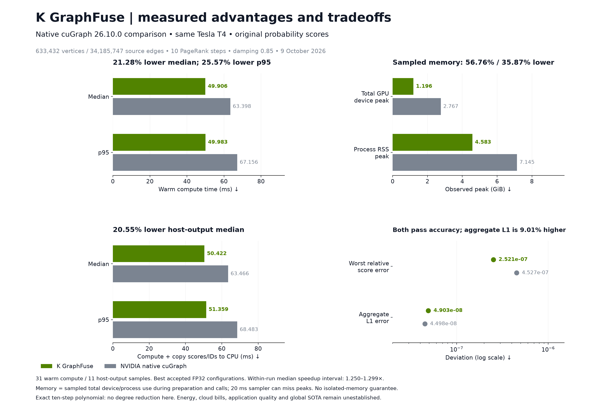

# K GraphFuse

**Reusable sparse graph filters, directional sensitivities, and optional GPU execution.**

**Created and maintained by [Utkarsh Sinha](https://github.com/Utkarsh-Sinha0).**
If this project supports your product or research, please credit **K GraphFuse by Utkarsh Sinha** and [cite the software](CITATION.cff).

[](https://github.com/Utkarsh-Sinha0/k-graphfuse/actions/workflows/ci.yml)
[](https://utkarsh-sinha0.github.io/k-graphfuse/)
[](LICENSE)

[Documentation](https://utkarsh-sinha0.github.io/k-graphfuse/) · [Quickstart](docs/getting-started/quickstart.md) · [API reference](docs/reference/api.md) · [Benchmark evidence](docs/benchmarks/results.md) · [Reproduce](docs/benchmarks/reproduce.md)

K GraphFuse compiles compatible linear graph stages into one ordered matrix polynomial, then evaluates it with sparse Horner recurrences. Reuse a copied operator and compiled plan across inputs. Optional backends cover CUDA execution, symmetric restarted resolvents, sparse local propagation, and derivatives with respect to one affine graph parameter.

It is useful when repeated graph ranking or linear propagation consumes a meaningful part of a workload. It requires matching graph semantics, independent accuracy checks, and enough repeated calls to recover preparation costs. Nonlinear graph neural networks, shortest paths, general graph transactions, and arbitrary dynamic topology updates are separate tasks.

## Measured competitive advantage

On the public Graphalytics `datagen-7_5-fb` ten-update PageRank task, the fastest accepted K GraphFuse configuration had **21.28% lower median warm compute time** than native NVIDIA `pylibcugraph 26.10.0` on the **same Tesla T4**. Final probability-score conversion is included in timing. Both outputs pass the same official per-vertex reference check.

| Metric | K GraphFuse | Native cuGraph | Observed change |
|---|---:|---:|---:|
| Warm median compute | 49.906 ms | 63.398 ms | 21.28% lower |
| Warm p95 compute | 49.983 ms | 67.156 ms | 25.57% lower |
| Median compute + host output | 50.422 ms | 63.466 ms | 20.55% lower |
| Sampled total device-memory peak | 1.285 GB | 2.971 GB | 56.76% lower |
| Sampled process RSS peak | 4.920 GB | 7.672 GB | 35.87% lower |

**Scope:** 633,432 vertices, 34,185,747 source edges, undirected unweighted graph, uniform start, damping 0.85, exactly ten updates; 31 synchronized warm samples. Memory is sampled total use at 20 ms intervals and may miss peaks. This is one workload and a configuration selection within one run. Aggregate L1 error is 9.01% higher, although both outputs pass the reference. Energy and cloud-bill savings are unmeasured. Global SOTA is unestablished; the earlier 19-workload suite passed zero of its strongest all-controls GPU improvement gates.

[Read the complete comparison and limitations](docs/benchmarks/results.md). Raw identifiers retain the historical name **Sinha GraphFuse**; the eight numerical core modules are byte-identical after the K GraphFuse rebrand.



## Install and run

Python 3.11 or newer; CPU use requires NumPy and SciPy. Clone the repository and install locally:

```sh
git clone https://github.com/Utkarsh-Sinha0/k-graphfuse.git
cd k-graphfuse
python -m pip install .
python examples/quickstart.py
```

```python
import numpy as np
from scipy.sparse import csr_array
from k_graphfuse import compile_sparse, evaluate_sparse

a = csr_array([[0., 0.5], [0.25, 0.]])
x = np.array([[1.], [2.]])
stages = [[[[1]], [[1]]], [[[2]], [[1]]]]  # (I + A), then (2I + A)
plan = compile_sparse(a, stages, tolerance=0)
y = evaluate_sparse(plan, x)
```

For GPU use, install a CUDA-enabled PyTorch build compatible with your driver, then `python -m pip install ".[gpu]"`. Follow the [GPU guide](docs/guides/gpu.md). FP64 is the default; FP32 requires workload-specific acceptance. CUDA capture and packing can be slower or use more memory.

## Choose your path

| Need | Start here |
|---|---|
| Evaluate a linear graph-filter pipeline | [Quickstart](docs/getting-started/quickstart.md) |
| Integrate a reused CUDA operator | [GPU execution](docs/guides/gpu.md) |
| Differentiate a graph parameter | [Sensitivities](docs/guides/sensitivity.md) |
| Compute a symmetric restarted resolvent | [Resolvents and residual audit](docs/guides/resolvent.md) |
| Check a performance claim | [Results](docs/benchmarks/results.md), [methodology](docs/benchmarks/methodology.md), [raw evidence](evidence/README.md) |
| Assess ranking, fraud or retrieval fit | [Applications](docs/guides/applications.md) |
| Navigate with an AI coding agent | [AGENTS.md](AGENTS.md), [llms.txt](docs/llms.txt), [claims.json](docs/claims.json) |

## Verify and contribute

```sh
python -m unittest discover -s tests -v
python benchmarks/verify_evidence.py
python examples/sensitivity.py
python examples/resolvent.py
python -m pip install ".[docs]"
python -m mkdocs build --strict
```

CUDA tests skip when no CUDA device is available. Offline evidence verification recomputes reported timings and source hashes; it does not rerun large GPU experiments. See [contribution checks](CONTRIBUTING.md) and [support boundaries](docs/reference/limitations.md).

## License and citation

New packaging and documentation use **Apache 2.0**; the historical numerical modules retain their **MIT** license. Preserve the applicable licenses and notices when redistributing. Requested visible credit: **“Powered by K GraphFuse by Utkarsh Sinha”**, linked to this repository. The requested citation does not add a mandatory UI-attribution restriction. [NOTICE](NOTICE) · [Citation and reuse](docs/project/citation.md) · [CITATION.cff](CITATION.cff).
