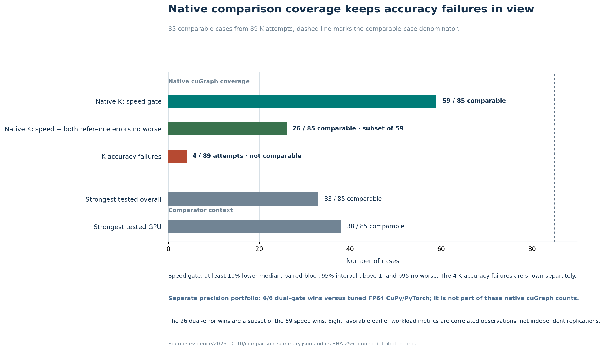

# Native cuGraph comparison

K GraphFuse passes the recorded strong speed gate in **59 of 89 attempted native-cuGraph cases (66.3%)**, or 69.4% of the 85 directly comparable cases. In **26 of 89 attempts (29.2%; 30.6% of comparable cases)**, it also has no worse aggregate L1 or maximum-relative reference error. The attempted-case denominator includes four cases in which K did not produce an accepted accuracy confirmation; all four are non-wins.

This page describes the 15-suite ranking study. The [precision GPU experiment](precision-gpu.md) evaluates a different source version and mathematical workload against FP64 CuPy/PyTorch. Do not pool their wins.

## Results at a glance

| Measure | Result | Interpretation |
|---|---:|---|
| Native-control cases attempted | 89 | 85 directly comparable plus four K accuracy failures |
| Lower K median latency | 76.5% (65/85) | Descriptive timing advantage |
| Strong K speed gate | 69.4% (59/85) | At least 10% lower median, confidence interval above one, p95 no worse |
| Both reference errors no worse | 55.3% (47/85) | Aggregate L1 and worst relative per-vertex errors |
| Strong speed gate and both errors no worse | 30.6% (26/85) | More restrictive measured advantage |
| Speed wins including accuracy failures | **59/89 (66.3%)** | Four failures are non-wins |
| Speed-and-error wins including failures | **26/89 (29.2%)** | Does not include unmeasured energy or memory |
| Same-precision subset | 76 cases; 67.1% (51/76) speed wins | Nine direct comparisons selected different precisions |

All 26 speed-and-error wins are in the same-precision subset. Compared configurations independently tune precision, coefficient packing, capture, approximation and native convergence settings where applicable. Acceptance matches the recorded task and error budgets; an accepted faster FP32 output is not an FP64 accuracy-equivalence claim.

## Compare against the strongest tested alternative

| Comparator set | Strong speed-gate passes |
|---|---:|
| Native cuGraph | 69.4% (59/85 comparable cases) |
| Fastest tested GPU control | 44.7% (38/85) |
| Fastest tested overall control, including CPU where measured | 38.8% (33/85) |

A native cuGraph win can coexist with a faster CuPy or SciPy implementation. CPU measurements follow the declared size limit; unmeasured CPU paths are not assumed slower. These are the strongest tested controls, not an exhaustive world-wide SOTA catalogue.

## Results by suite

| Suite | Comparable native cases | Strong speed wins |
|---|---:|---:|
| `convergence` | 14 | 4 |
| `directed-fixed` | 12 | 12 |
| `dynamic-rebuild` | 1 | 1 |
| `file-workflows` | 1 | 1 |
| `graphalytics` | 2 | 0 |
| `hard-graphs` | 15 | 13 |
| `independent-repeat` | 4 | 3 |
| `locality` | 6 | 6 |
| `precision-weights` | 13 | 3 |
| `public-snap` | 10 | 10 |
| `scale-density` | 7 | 6 |

The `file-workflows` and `dynamic-rebuild` rows above measure their resident ranking component. Complete workflow measurements below have a different outcome. Four additional failures occur in public personalized rankings and wide-range weighted precision cases; their records remain published.

## Selected public graphs

These are compute-stage measurements with accepted outputs. Here `s = native median / K median`; K compute-time reduction is `100 × (1 − 1/s)`, and the derived reciprocal-latency serial compute-rate increase is `100 × (s − 1)`. The last column is calculated from isolated median latency, not concurrent throughput. Medians are shown beside percentages to expose the comparison baseline.

| Graph and contract | K median ms | Native baseline ms | `s` (native/K) | Median compute time lower | Derived serial rate higher | Strongest recorded alternative |
|---|---:|---:|---:|---:|---:|---|
| facebook_combined, ten updates | 0.617 | 1.700 | 2.755x | 63.7% | 175.5% | K also passes fastest CuPy: 1.366/0.617 ms, `s=2.215x`, 54.9% less time, 121.5% higher derived rate |
| web-Google, ten updates | 7.548 | 14.453 | 1.915x | 47.8% | 91.5% | CuPy remains faster than K |
| com-dblp, ten updates | 2.005 | 5.726 | 2.856x | 65.0% | 185.6% | CuPy remains faster than K |
| com-youtube, ten updates | 7.124 | 16.233 | 2.279x | 56.1% | 127.9% | CuPy remains faster than K |
| roadNet-CA, ten updates | 7.390 | 20.985 | 2.839x | 64.8% | 184.0% | CuPy remains faster than K |

The corresponding potential applications are centrality refresh workers, link/citation scoring and graph-feature stages. Network importance on roadNet is not shortest-path routing. Ranking latency does not establish downstream retrieval, fraud or recommendation quality.

## Original matched-workload resource measurements

The [original same-T4 reference experiment](historical-reference.md) measured ten global PageRank updates on `datagen-7_5-fb`: 633,432 vertices, 34,185,747 source edges, uniform initialization and damping 0.85. Both selected implementations used FP32 and passed the official per-vertex reference check.

| Metric, lower is better | K GraphFuse | Native cuGraph baseline | Observed difference |
|---|---:|---:|---|
| Warm compute median | 49.906 ms | 63.398 ms | **21.28% less median time**; `s=1.2703x`; **27.03% higher derived serial rate** |
| Warm p95 latency | 49.983 ms | 67.156 ms | p95 latency was 25.57% lower; p95 is not a median-derived rate |
| Compute + host output median | 50.422 ms | 63.466 ms | 20.55% less median time; `s=1.2587x`; 25.87% higher derived serial rate |
| Compute + host output p95 latency | 51.359 ms | 68.483 ms | p95 latency was 25.01% lower; p95 is not a median-derived rate |
| First execution after GPU preparation | 61.941 ms | 70.695 ms | 12.38% less time; `s=1.1413x`; 14.13% higher derived rate; one observation |
| Sampled total GPU peak | 1.285 GB | 2.971 GB | K 56.76% lower |
| Sampled process RSS peak | 4.920 GB | 7.672 GB | K 35.87% lower |
| Worst relative per-vertex error | 2.521e-7 | 4.527e-7 | K 44.32% lower |
| Aggregate L1 error | 4.903e-8 | 4.498e-8 | K 9.01% higher |

Eight of these nine observations favor K. They are correlated measurements of one setup. GB is decimal. GPU/process memory includes inherited/library allocations, sampled every 20 ms; short peaks can be missed. Preparation scopes differ and are excluded from this count. Sampled board power was higher for K, 59.576 vs 41.844 W; integrated query energy was not measured.

A later 155-sample confirmation of this graph measured **K 56.089 ms vs native 54.667 ms**. The original 21.28% result therefore cannot serve as an unconditional or replicated speed advantage.

## Negative results and unsupported tasks

| Task | K median | Native baseline median | `s` (native/K) | K median-time reduction | K derived serial-rate change | Outcome |
|---|---:|---:|---:|---:|---:|---|
| Graph500-22 ten-update ranking | 435.741 ms | 160.189 ms | 0.368x | −172.0% (K took 172.0% more time) | −63.2% | Native reciprocal-median rate was 2.72x K’s |
| Later datagen confirmation | 56.089 ms | 54.667 ms | 0.975x | −2.6% (K took 2.6% more time) | −2.5% | Native slightly faster |
| File import through saved scores | 42.034 ms | 23.552 ms | 0.560x | −78.5% (K took 78.5% more time) | −44.0% | Native full workflow faster |
| Changing graph, rebuild through host output | 21.458 ms | 12.737 ms | 0.594x | −68.5% (K took 68.5% more time) | −40.6% | Native full workflow faster |
| BFS, shortest paths, components, triangles and Louvain | Not implemented in K | Native baselines recorded | — | — | — | No K win |

For these signed changes, a negative time reduction means K took longer; a negative derived-rate change means lower reciprocal-median rate. Complete-workflow rows are fixed-configuration diagnostics, without the held-out selection or confidence protocol of the resident study. They establish measured outcomes on those workflows, not every possible integration.

## Measurement and reproducibility

The complete study contains 15 suites, 111 case records and 2,190 candidate configurations. All 104 predeclared ranking/filter cases have records. Selected resident backends use five confirmation blocks of 31 synchronized samples. Pilot samples are excluded from final timings. The broad-suite interval resamples whole paired blocks and recomputes pooled median ratios. The strong speed gate requires `K_median <= 0.9 * comparator_median`, interval lower endpoint above one and K p95 no worse.

The stricter error screen compares the worst recorded block L1 and maximum-relative errors. It uses a rounded reference; this is a different oracle from the sampled high-precision precision study. The recollection of counts is not a new performance execution. Independent runs, hardware diversity and production workflows remain necessary for broader claims.

## Evidence files

- [All 85 direct comparisons, including losses](https://github.com/Utkarsh-Sinha0/k-graphfuse/blob/main/evidence/2026-10-10/native_comparisons.csv)
- [Four K accuracy failures](https://github.com/Utkarsh-Sinha0/k-graphfuse/blob/main/evidence/2026-10-10/K_accuracy_failures.json)
- [Audited comparison counts and source hashes](https://github.com/Utkarsh-Sinha0/k-graphfuse/blob/main/evidence/2026-10-10/comparison_summary.json)
- [All confirmed competitors](https://github.com/Utkarsh-Sinha0/k-graphfuse/blob/main/evidence/2026-10-10/detailed/confirmed_comparisons.csv)
- [Complete configuration search](https://github.com/Utkarsh-Sinha0/k-graphfuse/blob/main/evidence/2026-10-10/detailed/all_candidates.csv)
- [Full workflow diagnostics](https://github.com/Utkarsh-Sinha0/k-graphfuse/blob/main/evidence/2026-10-10/detailed/workflow_diagnostics.csv)

Run `python benchmarks/verify_evidence.py` from a repository checkout. See [methodology](methodology.md), [reproduction](reproduce.md), and [application fit](../guides/applications.md).
