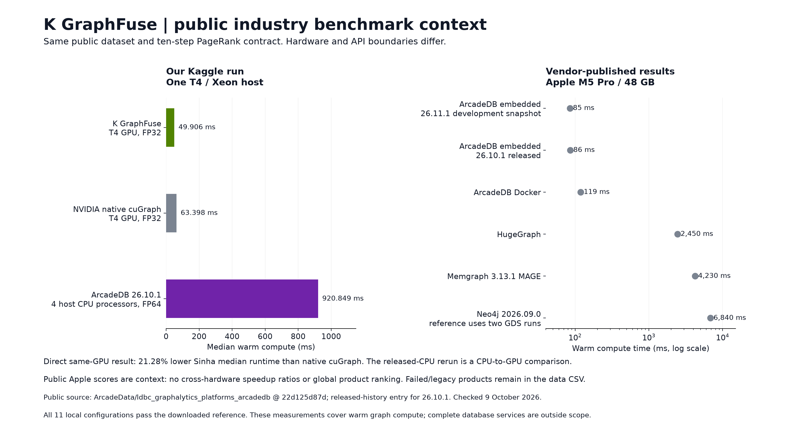

# Benchmark results and competitors

**Measured advantage:** on one matched public Graphalytics PageRank task, K GraphFuse has lower median warm compute time than native cuGraph on the same T4, lower observed total memory peaks, and accepted output accuracy. This is a scoped result. It does not establish a unique market position or global SOTA.

## Same-device native cuGraph comparison

The task is `datagen-7_5-fb`: 633,432 vertices, 34,185,747 source edges, 68,371,494 symmetrized operator entries, global undirected unweighted PageRank, uniform start, damping 0.85, exactly ten updates. Probability output is timed. Zero truncation retains the full finite polynomial. Measurements were recorded on 9 October 2026.

Best accepted K configuration: `torch.float32`, unpacked, eager (`capture=False`). Comparator: native `pylibcugraph 26.10.0` FP32 with cached graph and outgoing weight sums. Both run on Tesla T4 device 0 of the same machine. Only one GPU is used.

| Metric | K GraphFuse | Native cuGraph | Interpretation |
|---|---:|---:|---|
| Warm compute median | 49.905806 ms | 63.397649 ms | 21.28% lower; 1.270346× ratio |
| Warm compute p95 | 49.983254 ms | 67.156270 ms | 25.57% lower |
| Compute + host output median | 50.421915 ms | 63.465624 ms | 20.55% lower |
| Compute + host output p95 | 51.358547 ms | 68.483130 ms | 25.01% lower |
| First call after GPU preparation | 61.941168 ms | 70.695178 ms | 12.38% lower; one observation |
| Sampled total device peak | 1,284,702,208 B | 2,970,812,416 B | 56.76% lower observed total use |
| Sampled process RSS peak | 4,920,475,648 B | 7,672,205,312 B | 35.87% lower observed process use |
| Worst per-vertex relative error | 2.520975e-7 | 4.527438e-7 | Both below the `1e-4` acceptance gate |
| Aggregate L1 error | 4.903210e-8 | 4.498058e-8 | K is 9.01% higher |
| Sampled mean board power | 59.5755 W | 41.8442 W | K is higher; query energy was not integrated |

There are 31 synchronized warm and 11 host-output samples per GPU configuration. The descriptive within-run 95% bootstrap interval for the median ratio is **1.249605–1.298629×**, using 5,000 resamples and seed `20261009`. Selection among configurations is not corrected in this interval. No cross-run variance is estimated. All 11 measured configurations, including the CPU product, pass the downloaded per-vertex reference; 27 original tests pass with zero skips.

## Released CPU product on the same host

Unmodified ArcadeDB **26.10.1** embedded PageRank, using the released engine and normal Graph Analytical View, records median **920.849188 ms** and p95 **964.995717 ms** on four logical Xeon host processors. Maximum relative reference error is `4.987509e-15`. Preparation takes about `164.12 s` and is separate.

The ratio to the T4 result is approximately `18.45×` on this machine. This is a CPU-to-GPU deployment comparison with different processors and preparation scopes; it is not a pure algorithm comparison or an industry-wide product speedup. CPU peak memory and query energy were not measured. Keep CPU and GPU execution classes visible.

## Public product scores: separate hardware

The [pinned vendor-published Graphalytics comparison](https://github.com/ArcadeData/ldbc_graphalytics_platforms_arcadedb/blob/22d125d87ddbfd028ca2c50df6c5d000546349f9/README.md) reports Apple M5 Pro, 48 GB RAM, Temurin 25 and product-specific configurations. These are publisher results, not independently certified submissions. The [methodology](https://github.com/ArcadeData/ldbc_graphalytics_platforms_arcadedb/blob/22d125d87ddbfd028ca2c50df6c5d000546349f9/docs/benchmark-graphalytics-multivendor.md) explains product adaptations and excluded failures.

| Published product/configuration | Reported task time | Qualification |
|---|---:|---|
| ArcadeDB 26.10.1 released embedded | 86 ms | Apple M5 Pro result; not the local Xeon result |
| ArcadeDB 26.11.1 development snapshot | 85 ms | Unreleased snapshot, separate status |
| ArcadeDB Docker | 119 ms | Container setup differs |
| Neo4j 2026.09.0 / GDS | 6,840 ms | Two GDS runs combined to match the reference |
| Memgraph 3.13.1 / MAGE | 4,230 ms | Publisher configuration |
| HugeGraph | 2,450 ms | Publisher configuration |
| Kuzu, archived | 850 ms | Archived project; lifecycle differs |
| ArangoDB 3.11, legacy | 70,300 ms | Legacy configuration; not current default |

No speedup ratio divides a public Apple score by K GraphFuse's T4 timing. DuckPGQ and FalkorDB results that failed the reference are not accepted performance rankings. The raw public catalogue preserves statuses and unmeasured tasks. K GraphFuse has no exact matched `graph500-22` score in this release.

## Broader suite and negative evidence

The earlier three-run suite completes **19 unique workloads**, preserving **20 historical case records**, **466 candidates**, **283 accepted**, **27 not run**, and **18 exceptions**; remaining candidates fail acceptance. Its strongest all-controls GPU gate requires at least 10% lower median than the best accepted GPU control, a descriptive interval above one, and no p95 regression. **Zero of 19 complete workloads pass this gate.** The largest completed graph has five million vertices and 34,999,980 stored entries; it is a synthetic scale control.

Some older native-library comparisons used a symmetric-output adapter or sequential query batches. They are not the same contract as the native probability result above and are not substituted for it. Large same-library ratios should not be read as public product leadership.

## Reuse this claim accurately

> K GraphFuse recorded 21.28% lower median warm compute time than native NVIDIA cuGraph on the same Tesla T4 for the tested ten-update Graphalytics PageRank workload. Observed total memory peaks were lower, and both outputs passed the reference check. Wider performance leadership and customer savings remain unestablished.

Attach the graph, hardware, versions, timing boundary and limitations whenever reproducing the number. [Methodology](methodology.md) · [Audit and reproduction](reproduce.md) · [Machine-readable claims](../claims.json) · [Raw repository evidence](https://github.com/Utkarsh-Sinha0/k-graphfuse/tree/main/evidence).
