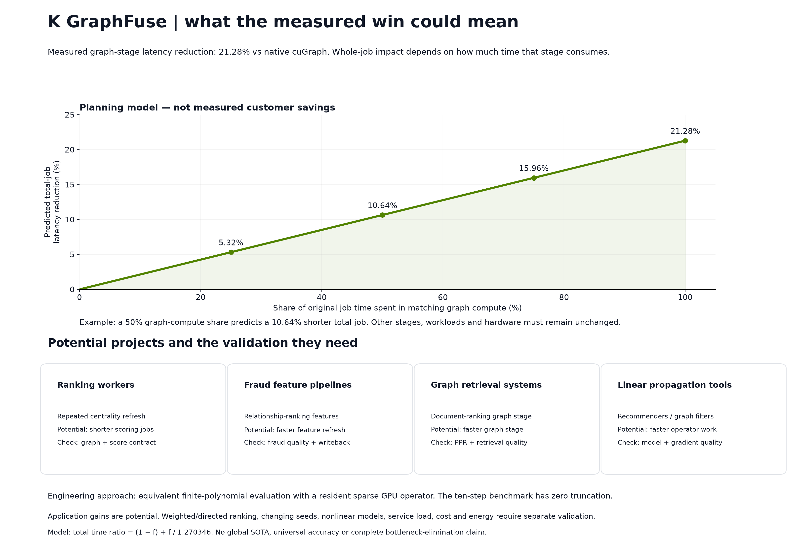

# Evaluate application fit

The new [controlled confirmation](https://utkarsh-sinha0.github.io/k-graphfuse/research/controlled-study/) uses the repaired implementation across six graph families and two GPUs. Matching-budget, matching-degree packed-balanced CuPy comparisons pass the strong speed gate in **18/20 pooled device–fixture comparisons**, with **36.88–83.71% less resident time in the wins**. R-MAT loses on both devices. MovieLens recommendation quality matches exactly, but specialized scalar-restart CuPy removes the application median speed advantage: K uses **7.13% more time on RTX** and practically ties T4. These are scoped experimental results, separate from native-cuGraph PageRank and the installed API.


The benchmark supports a repeated graph-computation opportunity. It does not establish measured customer savings or a replacement for a graph database service. Use the table below to define a concrete pilot and its acceptance gate.

## Prioritize a matching calculation

| Candidate project | Matching measured component | Why evaluate K | What must still be measured |
|---|---|---|---|
| Resident ranking refresh service | Fixed-update centrality on a reused graph | Facebook: **63.7% less median compute time** vs native (1.700/0.617 ms; `s=2.755x`; **175.5% higher derived serial rate**); vs fastest CuPy: **54.9% less** (1.366/0.617 ms; `s=2.215x`; **121.5% higher derived rate**) | Real graph distributions, output budget, freshness and complete request latency |
| Batch link/citation feature worker | PageRank stage | Selected public graphs: **47.8–65.0% less median compute time** (native/K `s=1.91–2.86x`; **91.5–185.6% higher derived serial rate**) | Faster CuPy alternatives still lead on some of those cases |
| Low-channel diffusion or graph-feature engine | Sparse matrix-valued polynomial, 4/16 FP64 channels | Precision experiment: **35.4–73.3% less median compute time** (`s=1.55–3.74x`; **54.9–273.9% higher derived serial rate**) with sampled accuracy gates | Actual operators/coefficient spectra, channels, transfers and build cost |
| Network/simulation sensitivity sweeps | Value plus derivative for one diagonal-node parameter direction | Precision experiment: **20.0–51.7% less median compute time** (`s=1.25–2.07x`; **25.0–107.2% higher derived serial rate**) with sampled accuracy gates | Engineering truth, parameter interval, derivative quality and scheduling |

The first two rows use the [native ranking study](../benchmarks/cugraph.md); the latter two use the [constructed precision experiment](../benchmarks/precision-gpu.md) against equivalent tuned FP64 CuPy/PyTorch controls. Each `s` is the control median divided by the K median; time reduction is `100 × (1 − 1/s)` and derived reciprocal-latency serial rate increase is `100 × (s − 1)`. This rate is not measured concurrent throughput. The precision implementation is experimental source outside the installed API. None of these results is a customer deployment.

Favor a pilot whose graph stays resident and whose repeated compatible calculation dominates runtime. A fast resident stage cannot compensate automatically for import, conversion, arbitrary graph changes, cold calls or writeback. Recorded complete file and rebuild workflows favored native cuGraph. For BFS, shortest paths, components, triangles or Louvain, K has no implemented comparison.

## Define the workflow contract

| Potential workflow | Bottleneck to investigate | Compatible component | Acceptance before adoption |
|---|---|---|---|
| Ranking refresh workers | Repeated rank computation over a reused graph | Finite global PageRank polynomial or compatible filter | Matching damping, iteration count, handling of dangling nodes, final probabilities and writeback latency |
| Fraud feature enrichment | Relationship centrality in batch scoring | Rank features or fixed linear graph propagation | Recall and false positives at fixed thresholds, freshness, full feature-pipeline cost |
| Graph retrieval | Repeated propagation from query seeds | Symmetric restarted resolvent where semantics match | Personalized scores, retrieval recall, seed transformation and complete response latency |
| Linear recommendation | Repeated fixed linear propagation | Compatible polynomial stages | nDCG/recall, stage ordering, training assumptions and invalidation cost |
| Engineering network models | Graph-filter evaluation and parameter sweeps | Sparse polynomials and one-direction sensitivity | Output and derivative budgets, represented operator fidelity and arithmetic-error requirements |

PageRank features appear in the [AWS Neptune fraud enrichment example](https://aws.amazon.com/blogs/database/use-amazon-neptune-analytics-to-analyze-relationships-in-your-data-faster-part-2-enhancing-fraud-detection-with-parquet-and-csv-import-and-export/). Personalized PageRank appears in the [AWS HippoRAG workflow](https://aws.amazon.com/blogs/machine-learning/hipporag-neurobiologically-inspired-rag-using-amazon-bedrock-amazon-neptune-and-personalized-pagerank/). These establish workflow relevance, not K GraphFuse performance or quality in those deployments.

## Estimate whole-job impact

For planning only, let `f` be the fraction of original job time spent in graph computation matching the measured task, and let `s=1.270346` be the observed stage speedup. If all other work stays constant:

```text
new_job_time / old_job_time = (1-f) + f/s
```

The measured stage medians were 63.398 ms native / 49.906 ms K (`s=1.270346x`): **21.28% less compute time**, equivalent to **27.03% higher derived stage serial rate**. At `f=0.5`, the model predicts **10.64% less total job time** and **11.91% higher derived reciprocal-latency job rate**. At `f=0.1`, it predicts **2.13% less total time** and **2.17% higher derived job rate**. These are Amdahl projections, not customer measurements. Transfer overhead, graph rebuilding, queues and parallel overlap can change the result.

For the separate 100k four-channel precision filter, the control/K medians were 4.334/1.159 ms (`s=3.739463x`): **73.26% less stage compute time** and **273.95% higher derived stage serial rate**. If that exact matching stage occupied half the original job and all other costs stayed constant, the model predicts **36.63% less total job time** and **57.80% higher derived reciprocal-latency job rate**. These are planning illustrations, not measured throughput, money, instance capacity or customer latency. Include every new overhead before using a projection in a business case.



## Run a useful pilot

1. Capture a representative graph, inputs and current production configuration.
2. Match directedness, normalization, dangling nodes, duplicates, weights, restart/damping and output coordinates.
3. Define accuracy and downstream-quality gates before choosing a configuration.
4. Measure import, normalization, compilation, preparation, warm calls, transfers and writeback.
5. Include graph refresh frequency, concurrency, cold requests and failure recovery.
6. Calculate money from observed billable resource use and actual provider pricing after measuring the full workflow.

Lower sampled memory suggests a capacity investigation. It does not guarantee a larger graph will fit or that a cheaper instance will suffice. Higher sampled board power means energy savings require integrated query measurements. No high-frequency trading alpha, trading profit, database transaction speedup or universal nonlinear-model acceleration is claimed.
