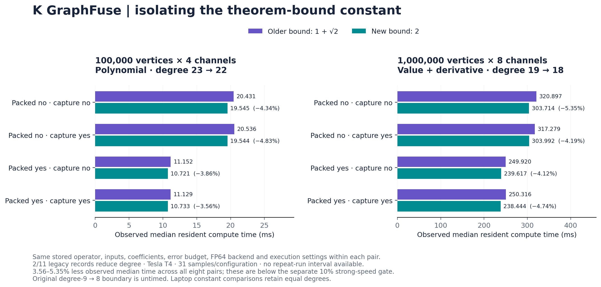

# Theorem-bound attribution: mathematical improvement to GPU work

The [theorem-bound attribution analysis](https://utkarsh-sinha0.github.io/k-graphfuse/research/bound-attribution/) separates the new complete-Crouzeix bound from balancing and GPU fusion. **Two of 11 legacy T4 workload records reduce degree: 23→22 and 19→18.** Across all eight accepted matched FP64 configurations in those two records, the new-bound plan records **3.56–5.35% less median resident time**, with lower observed p95. This is single-run evidence below the separate 10% strong-speed gate. The exact CPU 9→8 boundary is untimed; the checked laptop old/new-bound cases retain equal degrees.

## Mathematical effect

For the same nonzero matrix-valued value-tail residual upper bound S, the older numerical-range certificate uses `(1+sqrt(2)) S` and the new certificate uses `2 S`. Holding S and operator geometry fixed, its factor decreases by **17.1573%**. This is a mathematical certificate-factor improvement, not a runtime percentage.

The planner takes the minimum of the numerical-range and ordinary operator-norm bounds. If the ordinary norm bound is already tighter, or neither constant crosses a degree threshold, the stronger theorem can leave the selected degree unchanged. A smaller bounding constant can justify omitting additional terms under the same requested budget; it does not guarantee a more accurate floating-point output. Sensitivity certificates have their own formula and should not inherit the value-factor percentage without analysis.

The [earlier complete bound](https://doi.org/10.1137/17M1116672) is Crouzeix–Palencia's result. The [supplied constant-two complete result](https://github.com/openai/math/blob/fd4aeeb2ee4fc729c18d98444fed42fd0529eeeb/preprints/A-direct-proof-of-the-complete-Crouzeix-inequality-September-26-2026/paper.pdf) is attributed to OpenAI. Certificates here cover exact-arithmetic truncation; floating execution rounding is additional.

## Controlled attribution in existing measurements

This analysis uses existing 10 October 2026 Tesla T4 runs, re-examined on 11 October. Authenticated read-only access checked ten completed relevant Kaggle kernels and retrieved thirteen JSON outputs. The two degree-changing cases and every candidate sample exactly match the already published raw records. No new GPU timing was generated.

The immutable source constructs both plans from the same stored operator, feature matrix, rational coefficient matrices, error budget and affine direction/interval where applicable. It changes only the complete-bound constant: older `1+sqrt_upper(2)` versus default `2`. Both plans use the same PyTorch evaluator. FP64 pairs match packing and CUDA capture. All four execution settings are retained; rejected FP32 settings are excluded. Source manifests and encoded run sources are audited without executing the GPU code.

The examined matrix-filter/sensitivity records contain eleven workloads. Two change retained degree and nine do not. The eight timing pairs are four configurations of each degree-changing workload, not eight independent graphs. Each configuration has 31 consecutive synchronized samples; configuration order is shuffled. There is no paired repeated-block or independent-repeat interval for these measurements. The extraction is retrospective; it is not a newly predeclared confirmation experiment.

| Workload / FP64 setting | Degree old → new | Old / new median (ms) | Less time | Old / new p95 (ms) |
|---|---:|---:|---:|---:|
| Polynomial 100k × 4; packed=False, capture=False | 23 → 22 | 20.431 / 19.545 | 4.34% | 22.789 / 20.017 |
| Polynomial 100k × 4; packed=False, capture=True | 23 → 22 | 20.536 / 19.544 | 4.83% | 20.963 / 19.829 |
| Polynomial 100k × 4; packed=True, capture=False | 23 → 22 | 11.152 / 10.721 | 3.86% | 11.534 / 11.041 |
| Polynomial 100k × 4; packed=True, capture=True | 23 → 22 | 11.129 / 10.733 | 3.56% | 11.239 / 10.812 |
| Value + derivative 1M × 8; packed=False, capture=False | 19 → 18 | 320.897 / 303.714 | 5.35% | 321.765 / 304.441 |
| Value + derivative 1M × 8; packed=False, capture=True | 19 → 18 | 317.279 / 303.992 | 4.19% | 318.643 / 304.581 |
| Value + derivative 1M × 8; packed=True, capture=False | 19 → 18 | 249.920 / 239.617 | 4.12% | 250.566 / 240.175 |
| Value + derivative 1M × 8; packed=True, capture=True | 19 → 18 | 250.316 / 238.444 | 4.74% | 250.619 / 238.739 |


The polynomial uses 100,000 vertices, four channels and budget `1e-12`. The value-plus-derivative case uses 1,000,000 vertices, eight channels and budget `1e-8`; endpoint checks are also recorded. All listed FP64 candidates pass their recorded acceptance gates. A representative packed/captured comparison is 11.129→10.733 ms for the polynomial and 250.316→238.444 ms for the sensitivity. Both observed p95 values decrease.



## Numerical output checks

The full-degree FP64 SciPy/NumPy output is the recorded reference. Differences are Frobenius output error divided by input Frobenius norm; sensitivity cells list value and derivative components. Both methods pass the same requested gate. These rounded-reference differences are not an arbitrary-precision truth check and do not assert universal accuracy improvement.

| Workload / packing / capture | Old normalized CPU difference | New normalized CPU difference |
|---|---:|---:|
| Polynomial 100k × 4; packed=False, capture=False | 0.000e+00 | 0.000e+00 |
| Polynomial 100k × 4; packed=False, capture=True | 0.000e+00 | 0.000e+00 |
| Polynomial 100k × 4; packed=True, capture=False | 0.000e+00 | 0.000e+00 |
| Polynomial 100k × 4; packed=True, capture=True | 0.000e+00 | 0.000e+00 |
| Value + derivative 1M × 8; packed=False, capture=False | 3.783e-19 / 7.524e-19 | 1.242e-18 / 2.320e-18 |
| Value + derivative 1M × 8; packed=False, capture=True | 3.783e-19 / 7.524e-19 | 1.242e-18 / 2.320e-18 |
| Value + derivative 1M × 8; packed=True, capture=False | 3.783e-19 / 7.524e-19 | 1.242e-18 / 2.320e-18 |
| Value + derivative 1M × 8; packed=True, capture=True | 3.783e-19 / 7.524e-19 | 1.242e-18 / 2.320e-18 |


## CPU boundary and laptop evidence

The CPU sparse record already demonstrates a degree-only boundary: older complete bound **9**, new complete bound **8**, ordinary norm bound **10**, at selected tolerance `2.8361371852467578e-05`. This boundary deliberately crosses a degree threshold. It contains no latency samples.

For the RTX 3060 Laptop GPU's six explicit old/new-constant cases, the recorded degrees match: **15/15** for four-channel polynomial cases, **16/16** for the sixteen-channel case and **18/18** for value-plus-derivative cases. Their similarity-aware degrees of 9 or 10 involve a coordinate change and cannot be relabeled as a constant-only 9→8 comparison. A literal degree-9-versus-8 GPU time, or an isolated laptop degree-changing time, remains absent from the checked records.

## Contribution and practical interpretation

The stronger theorem is attributed to OpenAI. K GraphFuse's supported contribution is a computational application: an explicit truncation planner and inspectable integration, with evidence that the strengthened bound can remove a propagation stage and reduce observed GPU time on the stated inputs. This sharpens the research-paper contribution beyond aggregate benchmark gains. Worldwide-first application, a fundamentally new general algorithm and global SOTA remain unestablished. The similarity-transfer proof is supporting elementary analysis; it is not the source theorem.

The observed 3.56–5.35% changes are below the separate 10% strong-speed threshold. They add no native-cuGraph win, do not change the controlled study's 18/20 denominator and do not imply energy, memory, cloud-bill or recommendation-quality improvement. The complete MovieLens workflow still shows quality parity, an RTX median loss and a practical T4 tie against specialized CuPy.

## Reproduce the audit

```sh
python studies/bound_attribution_20261011/extract.py --verify
python studies/bound_attribution_20261011/figure.py
```

The first command uses installed CPU dependencies; it needs no GPU, credentials or network. The figure command additionally uses Matplotlib. [Summary and checksum manifests](https://github.com/Utkarsh-Sinha0/k-graphfuse/tree/main/studies/bound_attribution_20261011) link to immutable public source records and the preserved CPU boundary. The full repository audit runs this extraction automatically.

- [Polynomial raw measurements](https://github.com/Utkarsh-Sinha0/k-graphfuse/blob/main/evidence/2026-10-10/detailed/raw/matrix-filters/results.json)
- [Sensitivity raw measurements](https://github.com/Utkarsh-Sinha0/k-graphfuse/blob/main/evidence/2026-10-10/detailed/raw/sensitivity/results.json)
- [Laptop raw comparison](https://github.com/Utkarsh-Sinha0/k-graphfuse/blob/main/experiments/precision_gpu/LOCAL_RESULTS.json)
- [Closest-method review](closest-methods.md), [controlled study](controlled-study.md), [revised paper](paper.md)

Source and statistics validation establish artifact consistency, not independent peer review or repeated-hardware confirmation. Private download logs, credentials and host paths are excluded. This is an analysis of recorded results; the installed 0.1.0 API and frozen numerical sources are unchanged.

The comparison changes the implemented general bound. It does not rule out sharper preexisting class-specific bounds for these operators; that review is required before claiming the new general theorem was necessary to certify the tested inputs.
