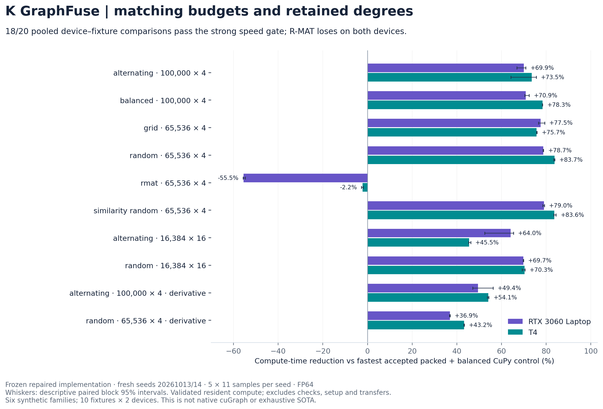
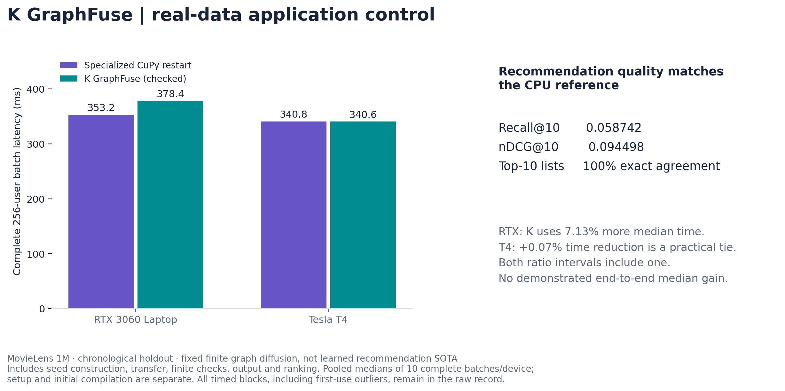

# Controlled study: contributions, components and application outcomes

The specific contribution is an inspectable integration of **original-coordinate error-budget planning for finite sparse matrix-valued polynomial actions and fixed affine sensitivities, with selective compensated CUDA execution**, plus a controlled regime map that separates coordinate choice, execution fusion and compensation. The similarity transfer proof is elementary supporting analysis. Balancing, polynomial graph filters, Horner evaluation, error-free transforms and sparse fusion are established prior art. Worldwide first priority for this integration is unestablished.

Read the [closest-method review](closest-methods.md) and [revised manuscript](paper.md). [Frozen methods and all raw outcomes](https://github.com/Utkarsh-Sinha0/k-graphfuse/tree/main/studies/controlled_20261010) and [recomputable summary](https://github.com/Utkarsh-Sinha0/k-graphfuse/blob/main/studies/controlled_20261010/SUMMARY.json) supply the evidence. This study is separate from historical native-cuGraph comparisons.

## Freeze, controls and accuracy contract

The primary protocol fixes a degree-32 polynomial, rational channel matrices with geometric decay, a single original-coordinate truncation budget of `1e-12`, and an additional `1e-13` empirical rounding-screen allowance. This screen is not a floating-roundoff proof. The six families are alternating asymmetric, already balanced, grid, random sparse, R-MAT and randomly similarity-scaled random operators. Ten fixtures vary size, 4/16 channels and two value-plus-derivative cases. Sensitivity timings/checks here use theta=0; interval planning remains conditional.

The fixed K profile is `fused_onepass_captured`, with current repaired sources pinned in `FREEZE.json`. The primary comparison includes six identity-coordinate FP64 CuPy/PyTorch controls with packing and supported capture. Twelve total methods isolate identity/one-pass/eight-sweep coordinates, identical-plan fusion, and compensation. The eight-sweep control uses simultaneous dyadic updates; it is Osborne-inspired and does not reproduce LAPACK DGEBAL's sequential algorithm. No optimal balancing claim is made.

Primary seeds 20261011/12 run in separate processes on RTX 3060 Laptop and Tesla T4. Five randomized paired blocks contain 11 synchronized resident samples per method per process, after three warmups. Owned outputs and original-coordinate scaling are included; validation, compilation, preparation and transfer are separate. Every large output is checked against a full finite-polynomial FP64 CPU reference. Every row of separate 64-row, four-channel fixtures across all six families is checked against 384-bit references cross-checked at 256 bits (discrepancy below `1e-65`). These small checks do not certify every large row at arbitrary precision.

During review, packing combined with balancing was identified as a stronger compatible control. A separate public `CONTROL_FREEZE.json` fixes that follow-up before fresh seeds 20261013/14. It compares packed one-pass and packed eight-sweep CuPy with the same fixed K profile. All selected control/K retained degrees match in that confirmation. It was not part of the original freeze and is reported separately.

Point estimates and 95% intervals use the same pooled-median control/K ratio estimator. The analysis resamples paired whole blocks within each separate process, with 2,000 bootstrap draws and a fixed analysis seed. Intervals are descriptive, conditional on the observed fastest accepted control, and not multiplicity-adjusted. Pooling two coefficient/input seeds is a descriptive summary; it is not 110 independent graph observations. A strong speed gate requires at least 10% less median time, interval lower endpoint above one and no p95 regression.

## What the controlled experiments establish

The primary study passes the strong speed gate in **18/20 pooled device–fixture comparisons**. The stronger packed-balanced confirmation also passes **18/20**, with **36.88–83.71% lower pooled-median resident compute time in those 18 wins**. The remaining R-MAT comparison uses **55.52% more time on RTX** and **2.21% more on T4**. Ten fixtures times two devices form these 20 comparisons; they are not 20 independent graph families.

The primary study has 40 case-runs, 480 large method checks and 288 small whole-fixture method checks. The follow-up has another 40 case-runs and 120 large method checks; these reuse the ten graph fixtures with fresh coefficients/inputs. Every recorded healthy large and small method passes the matching screen. The largest K full-output normalized FP64 CPU difference in the primary aggregate is `1.416e-14`.

Balancing reduces the alternating q=4 value degree from **22 to 13** with condition penalty 8, giving **36.47% less T4 time on the same eager fused executor**. In the random q=4 fixture it instead raises degree **20 to 24**, causing **18.69% more T4 time** on that executor. Balanced/grid/full-degree fixtures have no degree reduction. Fusion gains therefore remain distinguishable from coordinate gains. The compensated control uses **1.50–6.05 times** the latency of the otherwise matching eager fused profile across the 20 pooled cases; the worst-of-two-seeds normalized CPU difference is no worse in only 6/20. These near-floor rounded-reference differences do not establish universal accuracy superiority or a compensated execution theorem.



### Stronger packed-balanced confirmation

Positive percentages mean less K compute time; negative percentages mean more. All degrees match. Controls are selected by the fastest accepted pooled median across the two modes; every mode remains in raw data.

The matching-degree CuPy set tightens the component comparison. It does not replace the primary PyTorch alternatives or establish the fastest of every possible combined framework method.

| Fixture / GPU | Accepted control | Degree control / K | Median control / K (ms) | Time reduction | Ratio (95% interval) | p95 control / K (ms) |
|---|---|---:|---:|---:|---:|---:|
| alternating 100,000 × 4 / RTX 3060 Laptop | `cupy_iterated_packed` | 13 / 13 | 3.585 / 1.078 | +69.93% | 3.326× (3.016–3.433) | 6.168 / 1.286 |
| balanced 100,000 × 4 / RTX 3060 Laptop | `cupy_onepass_packed` | 30 / 30 | 6.912 / 2.014 | +70.86% | 3.432× (3.380–3.621) | 12.310 / 2.686 |
| grid 65,536 × 4 / RTX 3060 Laptop | `cupy_onepass_packed` | 15 / 15 | 3.781 / 0.850 | +77.52% | 4.449× (4.266–4.833) | 6.146 / 0.973 |
| random 65,536 × 4 / RTX 3060 Laptop | `cupy_onepass_packed` | 24 / 24 | 7.948 / 1.695 | +78.68% | 4.690× (4.656–4.721) | 8.560 / 1.790 |
| rmat 65,536 × 4 / RTX 3060 Laptop | `cupy_onepass_packed` | 32 / 32 | 9.404 / 14.624 | -55.52% | 0.643× (0.642–0.646) | 11.493 / 14.689 |
| similarity random 65,536 × 4 / RTX 3060 Laptop | `cupy_iterated_packed` | 32 / 32 | 10.702 / 2.249 | +78.98% | 4.757× (4.652–4.806) | 12.271 / 2.460 |
| alternating 16,384 × 16 / RTX 3060 Laptop | `cupy_onepass_packed` | 13 / 13 | 3.111 / 1.119 | +64.03% | 2.780× (2.105–2.883) | 4.367 / 1.479 |
| random 16,384 × 16 / RTX 3060 Laptop | `cupy_onepass_packed` | 24 / 24 | 7.698 / 2.329 | +69.74% | 3.305× (3.290–3.322) | 8.470 / 2.374 |
| alternating 100,000 × 4 + derivative / RTX 3060 Laptop | `cupy_iterated_packed` | 15 / 15 | 8.002 / 4.047 | +49.42% | 1.977× (1.892–2.284) | 12.070 / 4.080 |
| random 65,536 × 4 + derivative / RTX 3060 Laptop | `cupy_onepass_packed` | 28 / 28 | 17.999 / 11.361 | +36.88% | 1.584× (1.579–1.588) | 20.193 / 11.437 |
| alternating 100,000 × 4 / T4 | `cupy_onepass_packed` | 13 / 13 | 3.968 / 1.051 | +73.52% | 3.776× (2.788–4.086) | 5.995 / 2.238 |
| balanced 100,000 × 4 / T4 | `cupy_onepass_packed` | 30 / 30 | 8.990 / 1.948 | +78.33% | 4.614× (4.589–4.631) | 9.372 / 2.204 |
| grid 65,536 × 4 / T4 | `cupy_iterated_packed` | 15 / 15 | 3.487 / 0.847 | +75.71% | 4.116× (4.105–4.155) | 3.667 / 0.851 |
| random 65,536 × 4 / T4 | `cupy_onepass_packed` | 24 / 24 | 10.537 / 1.716 | +83.71% | 6.140× (5.969–6.177) | 11.032 / 1.862 |
| rmat 65,536 × 4 / T4 | `cupy_iterated_packed` | 32 / 32 | 11.821 / 12.082 | -2.21% | 0.978× (0.974–0.982) | 12.843 / 12.182 |
| similarity random 65,536 × 4 / T4 | `cupy_onepass_packed` | 32 / 32 | 14.624 / 2.402 | +83.58% | 6.089× (6.045–6.416) | 15.345 / 2.911 |
| alternating 16,384 × 16 / T4 | `cupy_onepass_packed` | 13 / 13 | 2.126 / 1.158 | +45.52% | 1.835× (1.825–1.859) | 2.294 / 1.168 |
| random 16,384 × 16 / T4 | `cupy_onepass_packed` | 24 / 24 | 8.620 / 2.558 | +70.33% | 3.370× (3.253–3.386) | 9.089 / 2.818 |
| alternating 100,000 × 4 + derivative / T4 | `cupy_iterated_packed` | 15 / 15 | 8.491 / 3.900 | +54.07% | 2.177× (2.156–2.190) | 8.920 / 4.308 |
| random 65,536 × 4 + derivative / T4 | `cupy_onepass_packed` | 28 / 28 | 24.479 / 13.904 | +43.20% | 1.761× (1.758–1.764) | 25.575 / 15.042 |


### Primary identity-coordinate comparison

This includes independently supported packed/captured framework paths. It separates the initial fixed comparison set from the stronger follow-up.

| Fixture / GPU | Accepted control | Degree control / K | Median control / K (ms) | Time reduction | Ratio (95% interval) | p95 control / K (ms) |
|---|---|---:|---:|---:|---:|---:|
| alternating 100,000 × 4 / RTX 3060 Laptop | `cupy_identity_packed` | 22 / 13 | 5.325 / 0.962 | +81.94% | 5.538× (5.488–5.874) | 7.864 / 0.985 |
| balanced 100,000 × 4 / RTX 3060 Laptop | `cupy_identity_packed` | 30 / 30 | 7.088 / 2.049 | +71.10% | 3.460× (3.400–3.793) | 10.232 / 2.362 |
| grid 65,536 × 4 / RTX 3060 Laptop | `cupy_identity_packed` | 15 / 15 | 3.657 / 0.871 | +76.20% | 4.201× (3.886–4.457) | 5.425 / 0.895 |
| random 65,536 × 4 / RTX 3060 Laptop | `cupy_identity_packed` | 20 / 24 | 7.196 / 1.693 | +76.47% | 4.250× (4.227–4.283) | 7.694 / 1.776 |
| rmat 65,536 × 4 / RTX 3060 Laptop | `cupy_identity_packed` | 32 / 32 | 10.131 / 14.755 | -45.64% | 0.687× (0.683–0.688) | 10.848 / 14.870 |
| similarity random 65,536 × 4 / RTX 3060 Laptop | `cupy_identity_packed` | 32 / 32 | 11.686 / 2.256 | +80.69% | 5.179× (5.099–5.215) | 12.461 / 2.849 |
| alternating 16,384 × 16 / RTX 3060 Laptop | `torch_identity_packed_captured` | 23 / 13 | 3.025 / 1.130 | +62.65% | 2.677× (2.656–2.700) | 3.153 / 1.205 |
| random 16,384 × 16 / RTX 3060 Laptop | `torch_identity_packed_captured` | 20 / 24 | 4.667 / 2.381 | +48.98% | 1.960× (1.942–1.974) | 4.864 / 2.526 |
| alternating 100,000 × 4 + derivative / RTX 3060 Laptop | `cupy_identity_packed` | 26 / 15 | 12.628 / 4.221 | +66.57% | 2.992× (2.833–3.285) | 17.858 / 4.671 |
| random 65,536 × 4 + derivative / RTX 3060 Laptop | `cupy_identity_packed` | 23 / 28 | 16.632 / 12.627 | +24.08% | 1.317× (1.257–1.378) | 18.962 / 14.519 |
| alternating 100,000 × 4 / T4 | `cupy_identity_packed` | 22 / 13 | 6.907 / 0.912 | +86.80% | 7.573× (7.429–7.607) | 7.529 / 0.936 |
| balanced 100,000 × 4 / T4 | `cupy_identity_packed` | 30 / 30 | 9.272 / 1.955 | +78.91% | 4.742× (4.550–4.807) | 10.374 / 2.532 |
| grid 65,536 × 4 / T4 | `cupy_identity_packed` | 15 / 15 | 3.675 / 0.842 | +77.09% | 4.365× (4.285–4.390) | 4.128 / 0.850 |
| random 65,536 × 4 / T4 | `cupy_identity_packed` | 20 / 24 | 9.485 / 1.714 | +81.93% | 5.535× (5.153–5.604) | 10.042 / 2.063 |
| rmat 65,536 × 4 / T4 | `cupy_identity_packed` | 32 / 32 | 12.995 / 12.489 | +3.90% | 1.041× (1.034–1.055) | 13.768 / 13.009 |
| similarity random 65,536 × 4 / T4 | `cupy_identity_packed` | 32 / 32 | 16.066 / 2.427 | +84.90% | 6.620× (6.513–6.906) | 16.861 / 3.456 |
| alternating 16,384 × 16 / T4 | `torch_identity_packed` | 23 / 13 | 3.316 / 1.162 | +64.95% | 2.853× (2.840–2.925) | 3.633 / 1.174 |
| random 16,384 × 16 / T4 | `torch_identity_packed` | 20 / 24 | 4.959 / 2.631 | +46.95% | 1.885× (1.850–1.920) | 5.424 / 3.001 |
| alternating 100,000 × 4 + derivative / T4 | `cupy_identity_packed` | 26 / 15 | 16.010 / 4.233 | +73.56% | 3.783× (3.719–3.819) | 16.313 / 4.588 |
| random 65,536 × 4 + derivative / T4 | `cupy_identity_packed` | 23 / 28 | 21.214 / 14.785 | +30.31% | 1.435× (1.417–1.445) | 22.149 / 15.727 |


### Coordinate component comparison

| T4 value-only fixture, q=4 | Identity / one-pass degree | Condition penalty | One-pass time reduction on the same fused executor |
|---|---:|---:|---:|
| alternating | 22 / 13 | 8 | +36.47% |
| balanced | 30 / 30 | 1 | -0.11% |
| grid | 15 / 15 | 1 | +0.24% |
| random | 20 / 24 | 2 | -18.69% |
| rmat | 32 / 32 | 64 | -0.70% |
| similarity random | 32 / 32 | 64 | -0.23% |


The [summary](https://github.com/Utkarsh-Sinha0/k-graphfuse/blob/main/studies/controlled_20261010/SUMMARY.json) contains all 120 pooled component comparisons, degrees, condition penalties, full-output errors and intervals. The paired comparisons hold the backend fixed; fusion comparisons hold the compiled plan fixed. The matched-degree follow-up holds the plan degree and requested accuracy fixed while changing execution.

## Complete recommendation workflow

The application is a reproducible **MovieLens 1M recommendation workflow** on real public ratings. Latest 20% of each user's timestamp-ordered ratings are held out. The training bipartite graph uses ratings >=4; all previously rated items are excluded from recommendations. There are 9,992 stored vertices, 944,258 stored positive-training edges and 256 deterministic eligible evaluation users, batched in four channels. The finite diffusion uses alpha=17/20 and degree 12. This is a fixed numerical recommender, not a trained recommendation quality-SOTA model.

Request timing includes seed construction, host-to-device transfer, checked numerical execution, device-to-host output, seen-item exclusion and stable top-10 ranking. Data load/graph construction, compilation and GPU preparation are recorded separately. `APPLICATION_FREEZE.json` fixes the stronger scalar-restart control before its separate runs: y0=(1-alpha)X, y[j+1]=alpha A y[j]+(1-alpha)X. This is algebraically the same finite polynomial, avoids unnecessary channel GEMMs, and receives the same finite input/output checks. Method order is shuffled within five whole-workflow blocks. All blocks remain recorded.

All healthy implementations have **Recall@10=0.0587420862**, **nDCG@10=0.0944984887** and **100% exact top-10 agreement** with the CPU finite-polynomial reference. The predeclared 0.001 absolute quality noninferiority margin passes. This demonstrates preserved application outcomes, not increased recommendation quality or relevance.

Against that specialized control, **K uses 7.13% more pooled-median time on RTX and is a practical tie on T4 (+0.07% time reduction)**. Both descriptive ratio intervals include one. There is no confirmed end-to-end median speed advantage. The generic matrix-coefficient application controls in the primary raw runs are weaker; their apparent gains are not the application headline.

The observed application p95 values include a large first-use CuPy outlier in each first-seed process. Some lazy compilation happens inside the first request, while other preparation happens before timing, and cache state is not reset uniformly. Those observed tails are retained but do not establish superior steady-state tail latency or a fair fully cold comparison. Compile/preparation fields are the last reported warm-cache setup, not a cold-start distribution. No cold-start break-even or customer-cost saving is established. Captured CuPy restart fails with `NotImplementedError` on both devices and is an unsupported control, not a K win.

The archive SHA-256 is `a6898adb50b9ca05aa231689da44c217cb524e7ebd39d264c56e2832f2c54e20`. Only ratings are parsed; demographics and the archive are not redistributed. [GroupLens research-use terms](https://files.grouplens.org/datasets/movielens/ml-1m-README.txt) apply separately; commercial use requires their permission. Cite Harper and Konstan, *The MovieLens Datasets: History and Context*, ACM TiiS (2015), [doi:10.1145/2827872](https://doi.org/10.1145/2827872).

| GPU | Specialized CuPy / K median (ms) | Time reduction | Ratio (95% interval) | Observed CuPy / K p95 (ms) |
|---|---:|---:|---:|---:|
| RTX 3060 Laptop | 353.198 / 378.386 | -7.13% | 0.933× (0.915–1.192) | 4668.271 / 422.594 |
| T4 | 340.838 / 340.595 | +0.07% | 1.001× (0.992–1.186) | 5668.892 / 411.505 |




## Reproduction and integrity

The initial local attempt had incompatible CUDA headers/NVRTC and incomplete CuPy controls. Its redacted exclusion ledger is retained. `RUNTIME_FREEZE.json` fixes compiler preloading before healthy repeats; the default CUB accelerator remains enabled and numerical sources stay unchanged. T4 uses CuPy 14.2.0 and PyTorch 2.11.0+cu128 with NVRTC 12.8; RTX uses the same framework versions with toolkit-selected NVRTC 13.4. These are two controlled devices, not independent external replication.

```sh
python studies/controlled_20261010/analyse.py --verify
python studies/controlled_20261010/runtime.py --seed 20261011 --output /your/results/run1.json --cache /your/data-cache
python studies/controlled_20261010/runtime.py --seed 20261012 --output /your/results/run2.json --cache /your/data-cache
python studies/controlled_20261010/controls.py --seed 20261013 --output /your/results/controls1.json
python studies/controlled_20261010/controls.py --seed 20261014 --output /your/results/controls2.json
python studies/controlled_20261010/application.py --seed 20261011 --output /your/results/application1.json --cache /your/data-cache
python studies/controlled_20261010/application.py --seed 20261012 --output /your/results/application2.json --cache /your/data-cache
```

The offline audit needs only the installed CPU dependencies. GPU reproduction additionally needs CuPy, CUDA PyTorch, Mpmath, threadpoolctl and certifi. Run the two seeds in separate processes on each device. Frozen runner/source hashes, raw-result hashes and the summary are checked by the repository audit. No ratings, credentials, private host paths or account logs are included.

## Adoption and scientific limits

Repeated low-channel sparse polynomial kernels are credible targets for evaluation where this exact numerical contract matches. R-MAT and the specialized recommendation control demonstrate why resident kernel gains cannot be converted directly into universal workflow or money claims. Energy, allocator peaks in this new study, concurrent service capacity, fully cold requests and customer bills are unmeasured. LAPACK DGEBAL, GE-SpMM, FusedMM and Chebyshev/Clenshaw-specific executors have not been run as equivalent controls; this is not exhaustive SOTA. The small arbitrary-precision tests and large FP64 checks do not replace an all-input execution-roundoff certificate.

Codex assisted implementation, analysis, graphics and manuscript drafting. Sources, output checks and audit records are supplied for inspection. This assistance and automated verification do not constitute scientific peer review or an external replication.

## Separate recovered theorem attribution

The [theorem-bound attribution analysis](https://utkarsh-sinha0.github.io/k-graphfuse/research/bound-attribution/) separates the new complete-Crouzeix bound from balancing and GPU fusion. **Two of 11 legacy T4 workload records reduce degree: 23→22 and 19→18.** Across all eight accepted matched FP64 configurations in those two records, the new-bound plan records **3.56–5.35% less median resident time**, with lower observed p95. This is single-run evidence below the separate 10% strong-speed gate. The exact CPU 9→8 boundary is untimed; the checked laptop old/new-bound cases retain equal degrees.

The ten-fixture controlled study uses the constant-two planner for its component controls. The retrospective legacy attribution therefore has its own inputs, timing protocol and denominator; it is not an additional controlled-study or native-cuGraph win.
